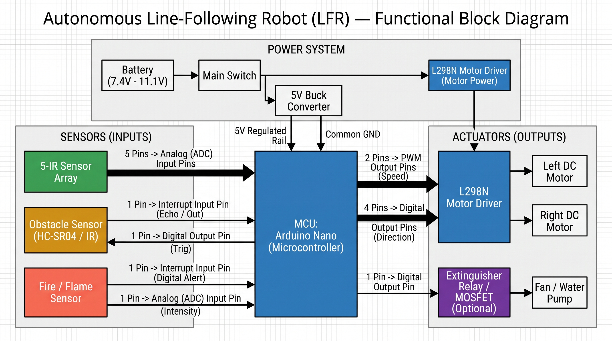

# Autonomous Line-Following Robot (LFR) with Obstacle & Fire Detection

-00979D?style=flat&logo=arduino&logoColor=white)


A beginner-friendly, end-to-end build guide for a multi-sensor **Line-Following Robot (LFR)** built around the **Atmega328p** and **L298N** motor driver. In addition to PID line tracking, the robot features real-time obstacle avoidance and hardware-interrupt fire detection with an optional extinguishing actuator.

---

## Table of Contents
- [System Architecture](#system-architecture)
- [Bill of Materials (BOM)](#bill-of-materials-bom)
- [Pin Mapping](#pin-mapping)
- [Power & Wiring Guide](#power--wiring-guide)
- [Firmware Setup](#firmware-setup)
- [Calibration & PID Tuning](#calibration--pid-tuning)
- [Repository Contents](#repository-contents)

---

## System Architecture



The firmware runs a **three-tier priority control loop**:
1. **Priority 1 — Fire Safety:** Hardware interrupt (`INT1`) + analog backup immediately halts the motors and triggers the extinguisher relay.
2. **Priority 2 — Obstacle Avoidance:** Non-blocking ultrasonic polling (`60 ms` interval) halts the robot before collisions.
3. **Priority 3 — PID Line Tracking:** Weighted 5-channel IR array error calculation for smooth differential steering.

---

## Bill of Materials (BOM)

| Component | Specification | Qty | Purpose |
| :--- | :--- | :---: | :--- |
| **Microcontroller** | Arduino Nano V3 (ATmega328P, 5V/16 MHz) | 1 | Main controller & PID loop |
| **Motor Driver** | L298N Dual H-Bridge Module | 1 | PWM speed & direction control |
| **Line Sensor** | 5-Channel IR Sensor Array | 1 | Track detection |
| **Obstacle Sensor** | HC-SR04 Ultrasonic *(or 3-pin IR Obstacle)* | 1 | Collision detection |
| **Fire Sensor** | IR Flame Sensor Module (AO + DO) | 1 | Flame detection & proximity |
| **Actuator (Optional)** | 5V Relay Module / MOSFET + 5V Fan or Pump | 1 | Fire extinguisher |
| **Motors & Wheels** | N20 or BO Geared DC Motors + Wheels | 2 | Differential drive |
| **Battery** | 2S (7.4V) or 3S (11.1V) Li-Ion / LiPo Pack | 1 | Main power supply |
| **Voltage Regulator** | 5V Buck Converter (LM2596 / MP1584, 2A+) | 1 | Stable 5V rail for MCU & sensors |

---

## Pin Mapping

> Full hardware details, ATmega328P ports, and timer budgets are available in [`docs/Arduino_Nano_Pin_Mapping.xlsx`](docs/Arduino_Nano_Pin_Mapping.xlsx).

| Subsystem | Signal | Arduino Pin | Mode | Notes |
| :--- | :--- | :---: | :--- | :--- |
| **L298N Motor Driver** | `ENA` (Left Speed) | `D5` | PWM (Timer0) | Remove `ENA` jumper on L298N |
| **L298N Motor Driver** | `ENB` (Right Speed) | `D6` | PWM (Timer0) | Remove `ENB` jumper on L298N |
| **L298N Motor Driver** | `IN1`, `IN2` (Left Dir) | `D7`, `D8` | Digital Out | Left motor polarity |
| **L298N Motor Driver** | `IN3`, `IN4` (Right Dir) | `D9`, `D10` | Digital Out | Right motor polarity |
| **5-IR Sensor Array** | `IR1` – `IR4` | `A0` – `A3` | Analog In | Far-Left (`A0`) to Mid-Right (`A3`) |
| **5-IR Sensor Array** | `IR5` (Far Right) | `A6` | Analog Only | Must use `analogRead()` |
| **Obstacle Sensor** | `ECHO` / `OUT` | `D2` | Digital In (`INT0`) | HC-SR04 Echo or 3-pin IR `OUT` |
| **Obstacle Sensor** | `TRIG` | `D4` | Digital Out | Leave unused for 3-pin IR |
| **Fire / Flame Sensor** | `FLAME_DO` | `D3` | Digital In (`INT1`) | Active-LOW hardware interrupt |
| **Fire / Flame Sensor** | `FLAME_AO` | `A7` | Analog Only | Lower value = stronger flame |
| **Extinguisher (Opt.)** | `EXT_RELAY` | `D12` | Digital Out | Drives relay/MOSFET |

> [!NOTE]
> **Why this pinout?** Using `D5`/`D6` (Timer0) for motor PWM keeps Timer1 (`D9`/`D10`) free for `Servo.h` and Timer2 (`D11`) free for `tone()`. Putting `IR5` on `A6` and `FLAME_AO` on `A7` keeps the hardware **I2C bus (`A4`/`A5`)** completely open for future upgrades like an OLED display or MPU6050 IMU.

---

## Power & Wiring Guide

1. **Battery Split:** Route Battery `(+)` through a main toggle switch to both the **L298N `12V` terminal** and the **5V Buck Converter `IN+`**.
2. **5V Logic Rail:** Set the buck converter to `5.0V` (verify with a multimeter first), then connect `OUT+` to the **Arduino Nano `5V` pin** and the `VCC` pins of all sensors.
3. **Common Ground:** Connect Battery `(-)`, Buck `GND`, L298N `GND`, Nano `GND`, and all sensor `GND` pins together.
4. **Motors:** Connect the Left Motor to `OUT1`/`OUT2` and the Right Motor to `OUT3`/`OUT4`.

> [!WARNING]
> - **Remove the `ENA` and `ENB` jumpers** on the L298N before connecting `D5` and `D6`.
> - **Unplug external 5V** from the Nano's `5V` pin before connecting the Nano to your PC via USB.
> - **Never power a fan or pump directly from `D12`** — always use a relay module or logic-level MOSFET with a flyback diode.

---

## Firmware Setup

Two complete implementations are included in `firmware/`:

### Option A: Arduino IDE (`firmware/arduino_ide/lfr_robot/lfr_robot.ino`)
1. Open `lfr_robot.ino` in the Arduino IDE.
2. Select **Tools → Board → Arduino Nano**.
3. If upload fails, switch **Tools → Processor** between `ATmega328P` and `ATmega328P (Old Bootloader)`.
4. Adjust the configuration flags at the top of the file (`USE_ULTRASONIC_OBS`, `LINE_IS_HIGH`, `RELAY_ACTIVE_LOW`) to match your hardware, then click **Upload**.

### Option B: Bare-Metal AVR-C (`firmware/avr_c/main.c`)
Compile and flash directly with `avr-gcc` and `avrdude`:
```bash
avr-gcc -mmcu=atmega328p -DF_CPU=16000000UL -Os -Wall firmware/avr_c/main.c -o main.elf
avr-objcopy -O ihex -R .eeprom main.elf main.hex
avrdude -c arduino -p m328p -P COM3 -b 115200 -U flash:w:main.hex:i
